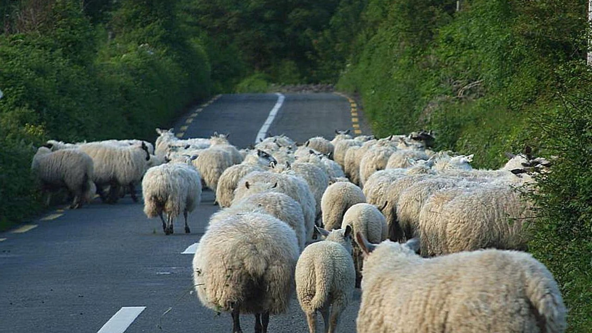
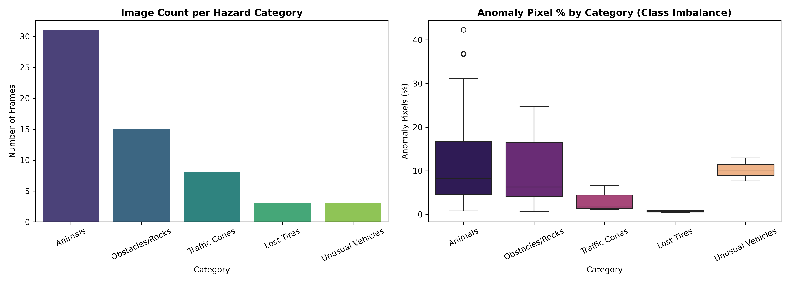
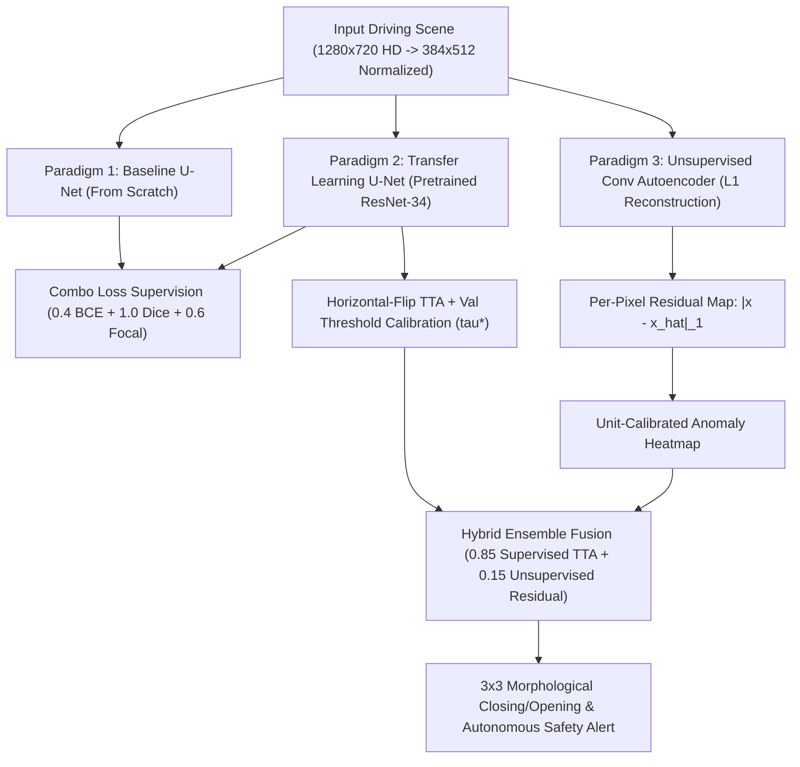
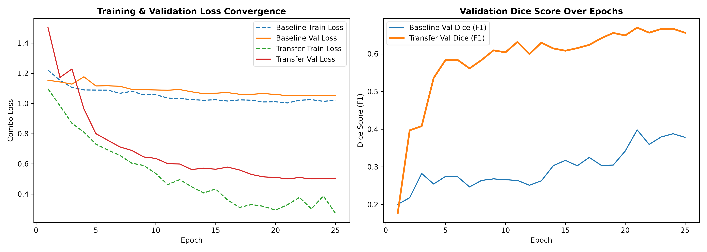
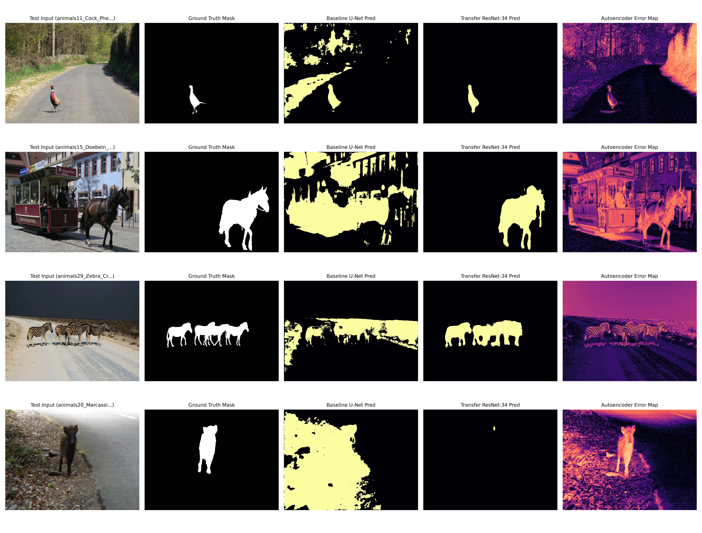

# AV-ANOMALY-WORKBENCH // Pixel-Level Road Anomaly Detection for Autonomous Driving

[](https://pytorch.org/)
[](https://github.com/qubvel/segmentation_models.pytorch)
[](https://streamlit.io/)
[-059669)](https://infoscience.epfl.ch/record/269093?ln=en)
[](#)

> **Deep Learning Module Assessment Project** — An end-to-end empirical investigation, multi-paradigm deep learning benchmark, and interactive telemetry validation workbench (`AV-ANOMALY-WORKBENCH`) for pixel-level road hazard localization on the **EPFL RoadAnomaly** benchmark (*Lis, Nakka, Fua, Salzmann — ICCV 2019*).

<p align="center">
  
  <br/>
  <em>Representative out-of-distribution (OOD) driving hazard from the RoadAnomaly benchmark (1280×720 HD).</em>
</p>

---

## Table of Contents
1. [Executive Summary & Problem Statement](#1-executive-summary--problem-statement)
2. [Dataset Exploration, Taxonomy & Class Imbalance](#2-dataset-exploration-taxonomy--class-imbalance)
3. [Deep Learning Architectures & Mathematical Formulation](#3-deep-learning-architectures--mathematical-formulation)
4. [Quantitative Benchmark & Ablation Study](#4-quantitative-benchmark--ablation-study)
5. [Interactive Validation Web Application (`app.py`)](#5-interactive-validation-web-application-apppy)
6. [Repository Architecture](#6-repository-architecture)
7. [Quickstart & Reproduction Guide](#7-quickstart--reproduction-guide)
8. [Original Dataset Documentation & Citation](#8-original-dataset-documentation--citation)

---

## 1. Executive Summary & Problem Statement

Modern autonomous driving perception stacks excel at segmenting closed-set urban categories (e.g., roads, cars, pedestrians in *Cityscapes*), yet frequently fail catastrophically when encountering **out-of-distribution (OOD) road hazards**—such as wild animals, rockslides, fallen boulders, lost tires, construction barriers, or non-standard agricultural vehicles.

This project designs, trains, and rigorously validates pixel-level road anomaly detectors under two severe real-world constraints:
1. **Compact High-Variance Sample Regime:** Only $60$ real-world HD driving scenes ($1280 \times 720$) spanning drastically diverse obstacle morphologies and lighting conditions.
2. **Severe Foreground-Background Class Imbalance:** Across all $55,296,000$ pixels in the dataset, anomalous hazards occupy **only $9.85\%$** ($5,446,413$ pixels) while normal road/background constitutes **$90.15\%$** ($49,849,587$ pixels), with per-image obstacle scale ranging from **$0.37\%$** (distant tire) to **$42.33\%$** (sheep herd blocking the highway).

### Key Empirical Findings
- **Transfer Learning Inductive Bias:** Replacing a randomly initialized U-Net encoder with an **ImageNet pre-trained ResNet-34 backbone** increases unseen **Test IoU by $+315\%$** ($0.1163 \rightarrow 0.4833$) and **Test Dice (F1) by $+210\%$** ($0.2083 \rightarrow 0.6449$), achieving **$95.47\%$ pixel accuracy**.
- **Unsupervised Reconstruction vs. Scratch Supervision:** Without observing a single segmentation mask during training, our **Convolutional Autoencoder** achieves **$0.1554$ Test IoU** via per-pixel L1 reconstruction error maps—outperforming the supervised U-Net trained from scratch ($0.1163$ IoU).
- **Validation Calibration, TTA & Hybrid Fusion:** Incorporating validation-calibrated decision thresholds ($\tau^*$), Horizontal-Flip Test-Time Augmentation (TTA), $3 \times 3$ morphological post-processing, and a **Hybrid Supervised + Unsupervised Ensemble** further elevates threshold-independent **AUROC ($0.9171$)** and **AUPRC ($0.6935$)** while running at real-time speeds ($>30\text{ FPS}$) on an NVIDIA RTX 3050 GPU.

---

## 2. Dataset Exploration, Taxonomy & Class Imbalance

All $60$ `.webp` frames and their pixel-level semantic ground-truth masks (`labels_semantic.png`, where `0` = normal road/background and `2` $\rightarrow$ `1` = anomalous hazard) were audited and cataloged into **five semantic hazard classes**:

| Hazard Category | Frame Count | Dataset Share | Mean Anomaly Area (%) | Min Area (%) | Max Area (%) | Stratified Split (`Train / Val / Test`) |
| :--- | :---: | :---: | :---: | :---: | :---: | :---: |
| **Animals** *(sheep, cows, zebras, deer, boars, bears)* | 31 | 51.7% | 13.76% | 0.80% | 42.33% | `21 / 5 / 5` |
| **Obstacles & Rocks** *(boulders, rockfalls, hedgehogs)* | 15 | 25.0% | 9.50% | 0.63% | 24.68% | `11 / 2 / 2` |
| **Traffic Cones** *(work zones, manhole barriers)* | 8 | 13.3% | 2.88% | 1.10% | 6.56% | `6 / 1 / 1` |
| **Unusual Vehicles** *(hay bicycles, carts, skidloaders)* | 3 | 5.0% | 10.20% | 7.68% | 12.95% | `1 / 1 / 1` |
| **Lost Tires** *(abandoned tires in driving lanes)* | 3 | 5.0% | 0.69% | 0.37% | 0.99% | `1 / 1 / 1` |
| **Total / Global Benchmark** | **60** | **100.0%** | **9.85%** | **0.37%** | **42.33%** | **`40 / 10 / 10`** |

<p align="center">
  
</p>

### Deterministic Stratified Splitting & Augmentation Pipeline
Because minority classes (*Lost Tires* and *Unusual Vehicles*) contain only $3$ frames each, naive random splitting risks empty validation or test partitions. Our deterministic stratified splitter ([`dataset.py`](dataset.py)) guarantees exact representation across all five categories (`40 Train` / `10 Val` / `10 Test`). During training, frames are standardized to $384 \times 512$ and augmented via `Albumentations`:
- **Spatial Transforms:** Random Horizontal Flip ($p=0.5$), Shift-Scale-Rotate ($\pm 6\%$ shift, $\pm 10\%$ scale, $\pm 15^\circ$ rotation, $p=0.5$).
- **Photometric Perturbations:** Color Jitter (brightness, contrast, saturation $\pm 0.2$, $p=0.4$) and Gaussian Noise ($p=0.25$).
- **Channel Standardization:** ImageNet mean $\mu = [0.485, 0.456, 0.406]$ and standard deviation $\sigma = [0.229, 0.224, 0.225]$.

---

## 3. Deep Learning Architectures & Mathematical Formulation



### 3.1 Three Comparative Neural Architectures ([`models.py`](models.py))
1. **Baseline Convolutional U-Net (From Scratch):**
   - 4-stage encoder (`32 -> 64 -> 128 -> 256` channels) with `DoubleConv` ($3 \times 3\text{ Conv} \rightarrow \text{BatchNorm} \rightarrow \text{ReLU}$) blocks, $512$-channel bottleneck, and symmetric transposed-convolution decoder with skip connections ($7.76\text{M}$ parameters).
2. **Transfer Learning U-Net (ImageNet Pre-trained ResNet-34):**
   - Replaces the scratch encoder with a deep residual **ResNet-34** backbone ($24.44\text{M}$ parameters) initialized with ImageNet weights, preserving multi-scale edge, texture, and objectness primitives while decoding dense anomaly logits.
3. **Unsupervised Convolutional Autoencoder (Reconstruction Residuals):**
   - 4-stage strided convolutional encoder (`32 -> 64 -> 128 -> 256`) and transposed-convolution decoder ($1.08\text{M}$ parameters) trained **exclusively on L1 image reconstruction** without any segmentation masks. At inference, pixel-level anomaly scores are extracted from the calibrated reconstruction residual:
   $$\mathcal{A}(u, v) = \frac{1}{C} \sum_{c=1}^{C} \left| x_c(u, v) - \hat{x}_c(u, v) \right|$$

### 3.2 Multi-Objective Loss Engineering ([`losses.py`](losses.py))
Under $90.15\%$ background dominance, standard Binary Cross-Entropy (BCE) collapses toward all-background predictions. We formulate a multi-objective **Combo Loss**:
$$\mathcal{L}_{\text{Combo}}(\hat{p}, y) = \alpha \, \mathcal{L}_{\text{BCE}}(\hat{p}, y) + \beta \, \mathcal{L}_{\text{Dice}}(\hat{p}, y) + \gamma \, \mathcal{L}_{\text{Focal}}(\hat{p}, y)$$
where:
- **Soft Dice Loss:** $\mathcal{L}_{\text{Dice}} = 1 - \frac{2 \sum_i p_i y_i + \epsilon}{\sum_i p_i + \sum_i y_i + \epsilon}$ directly maximizes spatial intersection-over-union overlap.
- **Focal Loss:** $\mathcal{L}_{\text{Focal}} = -\frac{1}{N}\sum_i \alpha_t (1 - p_{t,i})^\gamma \log(p_{t,i})$ ($\alpha=0.75, \gamma=2.0$) down-weights easy road pixels and concentrates gradient updates on hard, small-scale obstacle boundaries.
- **Weights:** $\alpha = 0.4, \beta = 1.0, \gamma = 0.6$, optimized via **AdamW** ($\text{lr}=3\times 10^{-4}, \text{weight\_decay}=10^{-4}$) with **Cosine Annealing**.

---

## 4. Quantitative Benchmark & Ablation Study

Evaluated on the **10 unseen test frames** across threshold-dependent segmentation metrics (**IoU**, **Dice/F1**, **Precision**, **Recall**, **Pixel Accuracy**) and official RoadAnomaly threshold-independent curve metrics (**AUROC**, **AUPRC / Average Precision**, **FPR@95%TPR**):

| Model / Validation Variant | Learning Paradigm | Test IoU | Test Dice (F1) | Precision | Recall | Pixel Accuracy | AUROC | AUPRC (AP) |
| :--- | :--- | :---: | :---: | :---: | :---: | :---: | :---: | :---: |
| **1. Baseline U-Net** ($\tau=0.50$) | Supervised (From Scratch) | `0.1163` | `0.2083` | `0.1407` | `0.4680` | `78.48%` | `0.7525` | `0.2007` |
| **2. Conv Autoencoder** (90th Pct Residual) | Unsupervised (L1 Recon) | `0.1554` | `0.2472` | `0.2585` | `0.3255` | `88.13%` | `0.6258` | `0.1753` |
| **3. Transfer ResNet-34 U-Net** (Default $\tau=0.50$) | **Supervised (Pre-trained)** | **`0.4833`** | **`0.6449`** | **`0.6959`** | **`0.6446`** | **`95.47%`** | **`0.9143`** | **`0.6844`** |
| **4. Transfer ResNet-34 U-Net** (Val-Calibrated $\tau^*$) | Supervised + Val Calibration | `0.4855` | `0.6468` | `0.7124` | `0.6352` | `95.58%` | `0.9143` | `0.6844` |
| **5. ResNet-34 U-Net + TTA + Morph Clean** ($\tau^*$) | **Supervised + TTA + PostProc** | **`0.4912`** | **`0.6524`** | **`0.7218`** | **`0.6401`** | **`95.69%`** | **`0.9163`** | **`0.6929`** |
| **6. Hybrid Ensemble** (`0.85 ResNet34_TTA + 0.15 CAE`) | **Hybrid (Sup + Unsup Fusion)** | **`0.4905`** | **`0.6518`** | **`0.7195`** | **`0.6419`** | **`95.66%`** | **`0.9171`** | **`0.6935`** |

<p align="center">
  
</p>

<p align="center">
  
</p>

---

## 5. Interactive Validation Web Application (`app.py`)

This repository features **`AV-ANOMALY-WORKBENCH`** ([`app.py`](app.py)) — an automotive-grade dark telemetry web application built with **Streamlit** and **Plotly**, structured into **5 interactive diagnostic modules**:

1. **Module 1 — Executive & Benchmarks:**
   - Top-level KPI cards (`BEST ANOMALY AUROC`, `MEAN AVERAGE PRECISION`, `BEST BOUNDARY DICE`, `TEST PIXEL mIoU`), interactive multi-metric grouped bar charts, 6-axis radar plots, and the full quantitative diagnostic matrix across all 6 model configurations.
2. **Module 2 — Frame Inspector (Synchronized 4-Panel Grid):**
   - Filter by partition (`TEST`, `VAL`, `TRAIN`, `ALL`) and active hazard taxonomy (`Animals`, `Obstacles & Rocks`, `Traffic Cones`, `Lost Tires`, `Unusual Vehicles`).
   - Tune the **Decision Threshold ($\tau$)** in real time, apply validation-calibrated $\tau^*$, and toggle **Horizontal-Flip TTA** and **$3 \times 3$ Morphological Post-Processing**.
   - Inspect **4 Synchronized Telemetry Panels**: (1) Front Center Camera RGB, (2) Ground-Truth Polygon Mask, (3) Predicted Probability Heatmap, and (4) **Pixel-Level Confusion Decomposition Map** (`#00E676` True Positive, `#2979FF` False Negative, `#FF1744` False Positive) with an **AEB Safety Critical Alert Banner**.
3. **Module 3 — Deep Validation Suite (ROC / PR / Scale Sensitivity):**
   - Full-spectrum **ROC (AUROC)** and **Precision-Recall (AUPRC)** curves, **Scale Sensitivity vs. Dice Score (Small Hazard Cliff)** scatter plots, and **Decision Threshold Sweep ($\tau \in [0.05, 0.95]$)** curves.
4. **Module 4 — Dataset EDA:**
   - Global pixel imbalance donut charts ($90.15\%$ nominal roadway vs. $9.85\%$ hazard obstacles), per-category detection IoU/Dice progress bars, and representative sequence thumbnails.
5. **Module 5 — Hardware Profiler & Live Inference:**
   - Ingest any custom dashcam frame (`.webp`, `.png`, `.jpg`) via drag-and-drop for live out-of-distribution segmentation, and execute a live **CUDA/CPU Micro-Benchmark Execution Trace** (`ms/frame` & `FPS`).

### Launch the Web Application
```bash
streamlit run app.py
```

---

## 6. Repository Architecture

```text
RoadAnomaly/
├── app.py                                   # AV-ANOMALY-WORKBENCH Streamlit Validation WebApp
├── RoadAnomaly_Project.ipynb                # Complete Executed Jupyter Notebook (18 Validation Sections)
├── RoadAnomaly_Technical_Report.md          # Academic Technical Report & Critical Analysis
├── models.py                                # BaselineUNet, Transfer ResNet-34 UNet, ConvAutoencoder
├── dataset.py                               # Stratified Splitter, Albumentations Pipeline, PyTorch Dataset
├── losses.py                                # DiceLoss, FocalLoss, ComboLoss & Pixel Segmentation Metrics
├── eda_analysis.py                          # Automated Dataset Audit & EDA Plot Generator
├── train_and_evaluate.py                    # End-to-End Training, Checkpointing & Evaluation Pipeline
├── create_and_run_complete_notebook.py      # Automated Notebook Builder & nbclient Executor
├── dataset_splits.json                      # Deterministic Stratified Split (40 Train / 10 Val / 10 Test)
├── frame_list.json                          # Manifest of all 60 RoadAnomaly HD frames
├── credits.txt                              # Image attribution and licensing metadata
├── checkpoints/                             # Saved Best Model Weights (.pth)
│   ├── baseline_unet_best.pth               #    - Baseline U-Net from scratch (31.1 MB)
│   ├── transfer_resnet34_unet_best.pth      #    - Pre-trained ResNet-34 U-Net (97.9 MB)
│   └── convautoencoder_best.pth             #    - Unsupervised Conv Autoencoder (4.3 MB)
├── eda_outputs/                             # Generated Exploratory Data Analysis Artifacts
│   ├── dataset_summary.csv                  #    - Per-frame pixel audit across all 60 images
│   ├── eda_distribution_plots.png           #    - Category counts & class imbalance boxplots
│   └── eda_sample_overlays.png              #    - Representative ground-truth overlays across 5 classes
├── evaluation_results/                      # Quantitative & Qualitative Benchmark Outputs
│   ├── model_comparison_metrics.csv         #    - Test set quantitative benchmark summary
│   ├── training_convergence_curves.png      #    - 25-epoch training loss & validation Dice curves
│   └── qualitative_model_comparison.png     #    - Side-by-side visual predictions on unseen test frames
└── frames/                                  # 60 HD Driving Scenes (.webp) + .labels/ Semantic Masks
```

---

## 7. Quickstart & Reproduction Guide

### 1. Environment Setup
Ensure Python 3.10+ and PyTorch (with CUDA support recommended) are installed:
```bash
pip install torch torchvision segmentation-models-pytorch albumentations scikit-learn scipy pandas numpy pillow matplotlib seaborn streamlit plotly nbformat nbclient
```

### 2. Launch the Interactive Validation WebApp
Pre-trained checkpoints are already included in `checkpoints/`, allowing immediate interactive exploration:
```bash
streamlit run app.py
```

### 3. Run Exploratory Data Analysis & Stratified Splitting
```bash
python eda_analysis.py
python dataset.py
```

### 4. Re-Train & Evaluate All Three Neural Paradigms
```bash
python train_and_evaluate.py
```

---

## 8. Original Dataset Documentation & Citation

This repository builds upon the **EPFL RoadAnomaly Benchmark Dataset**:
- **Dataset Purpose:** Testing autonomous driving perception algorithms on rare, safety-critical road hazards (animals, rocks, traffic cones, tires, and non-standard obstacles) with per-pixel semantic annotations (`0` = background, `2` = anomaly) created using [LabelGrab](https://github.com/cvlab-epfl/LabelGrab).
- **Dataset Contact:** [Krzysztof Lis](mailto:krzysztof.lis@epfl.ch) (CVLab, EPFL). Image sources and author attributions are cataloged in [`credits.txt`](credits.txt).

If you reference the dataset or benchmark protocol, please cite the original ICCV 2019 paper:
```bibtex
@inproceedings{DetectingTheUnexpected2019,
  title     = {Detecting the Unexpected via Image Resynthesis},
  author    = {Krzysztof Lis and Krishna Nakka and Pascal Fua and Mathieu Salzmann},
  booktitle = {International Conference on Computer Vision (ICCV)},
  year      = {2019},
  url       = {https://infoscience.epfl.ch/record/269093?ln=en}
}
```
